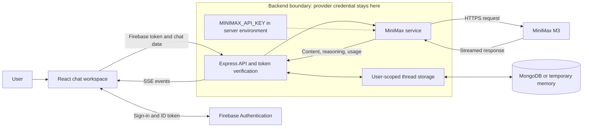

<div align="center">
  
  <h1>IntellixAI</h1>
  <p><strong>Streaming AI chat, built end to end.</strong></p>
  <p>A React workspace for conversation, coding help, and reasoning—backed by a JavaScript API for authentication, streaming, and conversation storage.</p>

  
  
  
  

  <p><a href="#engineering-highlights">Engineering</a> · <a href="#architecture">Architecture</a> · <a href="#quick-start">Quick start</a> · <a href="https://github.com/PrabhakarG001/IntellixAI">Repository</a></p>
</div>

> **Implementation status:** This README describes the MiniMax M3 migration in the local working tree. The application migration remains uncommitted and is excluded from this documentation-only update. A fresh checkout of `main` does not yet include that implementation or its new test commands. Live MiniMax access has not been verified.

<!-- Add a genuine application screenshot or GIF here when one is available. -->

## Overview

IntellixAI gives developers and curious learners one workspace for general questions, programming assistance, and reasoning tasks. It combines a conversational UI with server-managed context, streamed answers, and optional persistent history.

The engineering work spans the full request lifecycle: React state and cancellation, authenticated Express routes, a centralized provider boundary, SSE decoding across network packets, and per-user storage. The project emphasizes practical integration and explicit failure handling; it does not claim production scale or benchmark results.

## Engineering highlights

| Area | Implementation |
| --- | --- |
| Streaming lifecycle | Shared SSE decoder handles fragmented UTF-8, CRLF boundaries, usage events, and completion detection. Client cancellation propagates to the provider. |
| Authentication and isolation | Firebase ID-token verification protects chat routes; records are scoped to the signed-in user. |
| Provider boundary | One backend service calls MiniMax M3. Credentials stay server-side; the server fixes the model and endpoint. |
| Failure handling | Input limits, safe error categories, a two-minute provider timeout, and one retry for pre-stream transient failures. No provider fallback or fake answers. |
| State consistency | A synchronous frontend submission guard and per-process backend locks prevent concurrent generation on the same thread. Regeneration replaces the last exchange. |
| Testability | Node's test runner exercises service behavior, stream parsing, and real local HTTP integration with mocked provider responses. |

## What you can do

| Capability | What is implemented |
| --- | --- |
| Live conversations | Stream answers, stop generation, and regenerate the latest response. |
| Task modes | Talk, Coding, and Reasoning share the same MiniMax M3 model. |
| Personal history | Create, search, clear, and delete chats with automatic titles. Pinning and renaming are local UI state and reset on reload. |
| Readable answers | Markdown, code blocks, tables, task lists, and response/code copying. |
| Sign-in | Google login through Firebase Authentication. |
| Storage | MongoDB persistence when configured; temporary process memory otherwise. |
| Interface | Responsive dark layout, animated WebGL backgrounds, and loading states. |

## Technology stack

| Layer | Technologies |
| --- | --- |
| Frontend | React 19, Vite 7, React Router 7, Tailwind CSS 4, custom CSS |
| UI and rendering | Framer Motion, OGL, Lucide React, React Markdown, remark-gfm |
| Backend | Node.js, Express 5, JavaScript ES modules, native `fetch` |
| Authentication | Firebase Web SDK and Firebase Admin SDK |
| AI integration | Official MiniMax HTTP API, fixed to `MiniMax-M3` |
| Database and storage | MongoDB through Mongoose 9; optional process-memory storage |
| Development and hosting | npm, Node.js test runner; Vercel configuration for the frontend build only |

## Architecture



The browser never calls MiniMax directly. Express verifies the Firebase token, validates history, forwards provider events, and saves completed answers. Partial failures are reported explicitly. Reasoning events are separate from answer content; the UI does not currently display a separate reasoning panel.

<details>
<summary><strong>Project structure</strong></summary>

```text
Frontend/
  src/
    components/          Chat, sidebar, input, and visual effects
    config/              Task-mode definitions
    hooks/               Chat state and generation lifecycle
    pages/               Login page
    services/            Firebase, backend requests, SSE, and history helpers
    styles/              Global styling
  test/                  Transport and history tests
  vite.config.js         Plugins and local API proxy
backend/
  controllers/           Chat CRUD and response handlers
  models/                Conversation storage
  routes/                Authenticated API routes
  services/              Request validation and MiniMax integration
  utils/                 Authentication and safe errors
  scripts/               Live MiniMax smoke check
  test/                  Service and HTTP integration tests
  app.js                 Express application factory
  server.js              Environment, database connection, and startup
shared/                  SSE decoder shared by frontend and backend
package.json             Root install, run, build, and test scripts
vercel.json              Frontend build configuration
```

</details>

## Quick start

### Prerequisites

- Node.js **22.12 or newer**, npm, and Git. Vite 7 requires at least Node 22.12 on the 22.x line.
- A MiniMax API key with M3 access and available account quota.
- A Firebase project with Google sign-in enabled and frontend domains authorized.
- MongoDB only if persistent history is required.

The Firebase project in `Frontend/src/services/firebase.js` must match the backend's `FIREBASE_PROJECT_ID`.

### Clone and install

```sh
git clone https://github.com/PrabhakarG001/IntellixAI.git
cd IntellixAI
npm run install:all
```

The migration-status note above applies to fresh clones. Installation reads the root, frontend, and backend package manifests.

### Configure the backend

Create `backend/.env` if it does not exist, then edit it locally. Preserve existing environment files.

```dotenv
MINIMAX_API_KEY=your_minimax_api_key_here
PORT=5000
CLIENT_ORIGIN=http://localhost:5173,http://127.0.0.1:5173
FIREBASE_PROJECT_ID=your_firebase_project_id
# Optional: omit for temporary in-memory storage.
# MONGODB_URI=mongodb://127.0.0.1:27017/intellixai
```

| Variable | Purpose |
| --- | --- |
| `MINIMAX_API_KEY` | Backend-only credential required for AI requests. |
| `PORT` | Backend port; defaults to `5000`. |
| `CLIENT_ORIGIN` | Comma-separated frontend origin allowlist; defaults to the local origins above. |
| `FIREBASE_PROJECT_ID` | Firebase project for token verification; omission uses the existing project default. |
| `MONGODB_URI` | Optional database URI. Without it, chats reset on server restart. |
| `VITE_API_BASE_URL` | Optional **public frontend** setting; defaults to `/api`. Set before building. |

For a separately hosted backend, put its public URL in `Frontend/.env.local`:

```dotenv
VITE_API_BASE_URL=https://your-backend.example/api
```

The backend fixes the model and endpoint in `backend/services/minimaxService.js`; no model environment variable is needed:

```text
Model:    MiniMax-M3
Endpoint: POST https://api.minimax.io/v1/chat/completions
Auth:     Authorization: Bearer <MINIMAX_API_KEY>
```

See MiniMax's [invocation guide](https://platform.minimax.io/docs/guides/text-generation) and [Chat Completions reference](https://platform.minimax.io/docs/api-reference/text-openai-api). Talk and Coding disable thinking; Reasoning enables adaptive thinking. The service requests separate reasoning and usage, with an 8,192-token output limit including reasoning tokens.

### Start the application

Run each command from the repository root in a separate terminal:

```sh
# Terminal 1
npm run start:backend
```

```sh
# Terminal 2
npm run dev:frontend
```

Open `http://localhost:5173` and sign in. Vite proxies `/api` to `http://localhost:5000`. If either port changes, update the proxy/backend URL and the allowed frontend origin. When `MONGODB_URI` is set, startup waits for MongoDB and exits if the connection fails; otherwise, it warns that storage is temporary.

## Validation

From the repository root:

```sh
npm test
npm run build
```

Tests cover validation, failure classification, bounded retries, HTTP integration, regeneration, cancellation, concurrency, and fragmented streams. Provider responses and authentication are injected in integration tests; they do not verify real Firebase sign-in, MongoDB persistence, or MiniMax billing/access. No coverage percentage, lint script, or TypeScript check is claimed.

The build writes `Frontend/dist`. To preview it:

```sh
cd Frontend
npm run preview
```

Preview does not use Vite's development API proxy. Set `VITE_API_BASE_URL` before building when previewing against a separate backend.

To check the real MiniMax account, run from the root:

```sh
cd backend
npm run test:live
```

The live check sends a small, potentially billable request when a key exists. Missing credentials return `MINIMAX_NOT_CONFIGURED`. Mocked tests are not proof of live model access.

<details>
<summary><strong>API reference</strong></summary>

All `/api` routes require `Authorization: Bearer <FIREBASE_ID_TOKEN>`. This is a Firebase session token, not the MiniMax key.

| Method | Endpoint | Purpose |
| --- | --- | --- |
| `GET` | `/` | Public backend health response |
| `GET` | `/api/chats` | List the user's conversations |
| `GET` | `/api/chat/:id` | Retrieve a conversation |
| `POST` | `/api/new-chat` | Create a conversation |
| `DELETE` | `/api/chat/:id` | Delete a conversation |
| `POST` | `/api/chat/:id/clear` | Clear a conversation |
| `POST` | `/api/chat` | Return a complete JSON answer |
| `POST` | `/api/chat/stream` | Stream an SSE answer |

`/api/stream` aliases the streaming route. The router also mounts at `/api/intellix` with the same relative paths.

```json
{
  "message": "Explain this function.",
  "mode": "coding"
}
```

Optional fields include `chatId`, `thinkingMode` (`quick` or `deep`), and `regenerate`. Stream events include `meta`, `content`, `thought`, `usage`, `done`, and `error`.

</details>

## Deployment and current limits

Deploy Express as a Node service with access to the root `shared/` directory. Configure persistent MongoDB storage and exact frontend origins for a hosted installation.

The existing Vercel configuration builds the frontend only; it does not deploy Express or configure SPA history fallback. Configure the frontend host to serve `index.html` for application routes, and route `/api` to Express or set `VITE_API_BASE_URL` before building. Streaming requires proxy buffering to be disabled and request durations longer than the backend's two-minute timeout.

Locks and memory storage are per process. Multiple backend instances need shared coordination and persistent storage. No working public deployment or application screenshot is included here.

<details>
<summary><strong>Troubleshooting</strong></summary>

| Symptom | Check |
| --- | --- |
| `MINIMAX_NOT_CONFIGURED` / 503 | Set the backend key and restart Express. |
| `MINIMAX_AUTH` / 502 | Verify the key and MiniMax account access. |
| `MINIMAX_REQUEST` / 502 | Check M3 entitlement and input limits. |
| `MINIMAX_QUOTA` / 503 | Check account balance and quota. |
| HTTP 429 | Wait for the provider rate limit to clear. |
| HTTP 401 | Sign in again; verify both Firebase project configurations. |
| CORS rejection / 403 | Match the frontend scheme, hostname, and port in `CLIENT_ORIGIN`. |
| HTTP 409 | Wait for or stop the active generation in this thread. |
| Invalid stream, HTML, or network failure | Check backend availability and `/api` routing. A frontend-only host cannot serve Express. |
| Interrupted answer or timeout | Check connectivity and proxy streaming limits; retry or shorten the prompt. |
| History disappears | Configure MongoDB; process-memory history resets on restart. |
| MongoDB startup failure | Verify the URI, database availability, and network permissions. |

Errors after streaming starts arrive as SSE `error` events. MiniMax's [error-code reference](https://platform.minimax.io/docs/api-reference/errorcode) covers provider-side diagnostics.

</details>

## Security

- Keep provider keys and database credentials on the backend. Never use `VITE_MINIMAX_API_KEY` or `NEXT_PUBLIC_MINIMAX_API_KEY`.
- Vite environment variables are public build-time configuration. Use them only for values safe to expose.
- `.gitignore` excludes local environment files, dependencies, build outputs, caches, and private credential exports while allowing `.env.example` files. Review staged files before committing.
- Previously committed credentials must be revoked and rotated. Ignore rules protect future commits; they do not remove secrets from Git history.

## Next steps

These are future improvements, not shipped features:

- Publish the application migration and verify MiniMax with a real account.
- Add genuine UI screenshots and a verified deployment link.
- Persist pinned chats and custom titles through the backend.
- Add signed-in browser tests, real database integration checks, and coordination across backend instances.

## Explore and contribute

Browse the [source repository](https://github.com/PrabhakarG001/IntellixAI), report reproducible problems in [Issues](https://github.com/PrabhakarG001/IntellixAI/issues), or propose a focused change through [Pull requests](https://github.com/PrabhakarG001/IntellixAI/pulls). Keep secrets out of commits and run the applicable tests and production build before submitting changes.

**License:** `backend/package.json` declares ISC. No standalone repository-wide `LICENSE` file is included.
